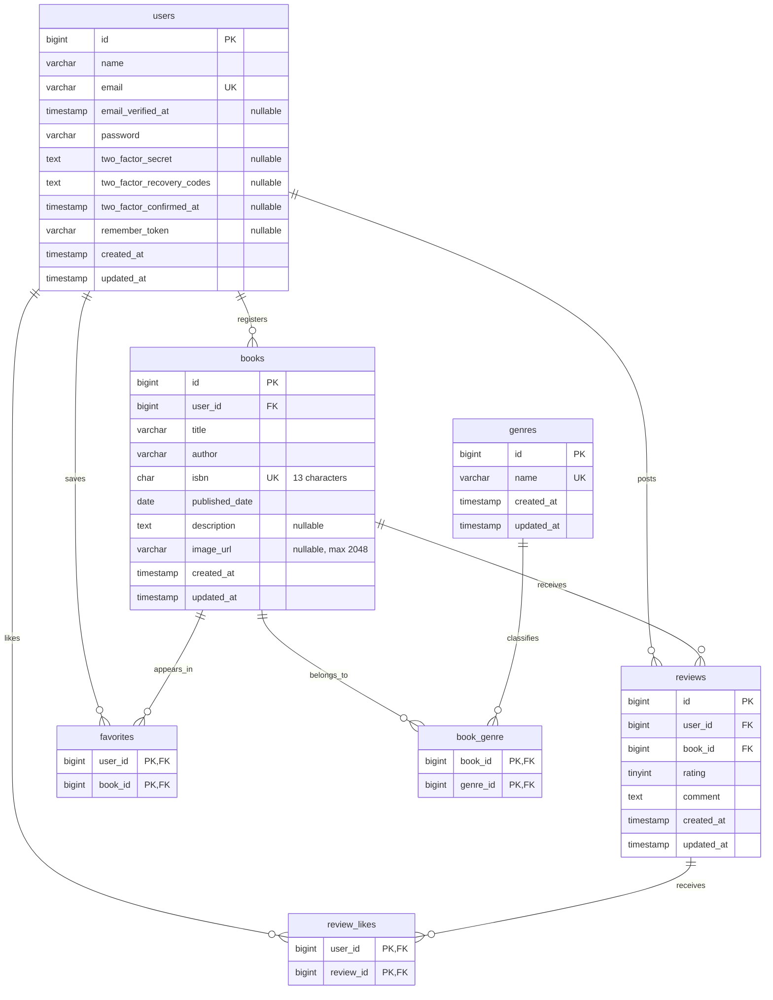

# BookShelf ― 書籍レビューアプリ

書籍の情報やレビューを共有できるWebアプリです。
学習課題の基本編として、書籍管理・レビュー・お気に入り・いいね・ジャンル管理・ランキング・書籍APIを実装しました。

## 主な機能

| 機能 | 内容 |
| --- | --- |
| 認証 | 会員登録・ログイン・ログアウト、日本語のエラーメッセージ |
| 書籍一覧・詳細 | 未ログインでも閲覧可能。一覧は登録日時の新しい順に10件ずつ表示 |
| Web画面の書籍管理 | ログイン後に登録可能。編集・更新・削除は登録者本人のみ可能 |
| レビュー | 評価とコメントを投稿可能。同じ書籍への投稿は1人1件まで |
| レビューの編集・削除 | 投稿者本人のみ可能 |
| お気に入り | ログイン中のユーザーが登録・解除でき、自分の一覧を10件ずつ表示 |
| いいね | ログイン中のユーザーがレビューへのいいねを登録・解除 |
| ジャンル管理 | ログイン後に一覧・詳細・登録・編集・削除が可能。書籍で使用中のジャンルは削除不可 |
| ランキング | レビューがある書籍を平均評価の高い順に最大10冊表示。同点の場合は書籍IDの昇順 |
| 書籍API | 書籍の一覧・検索・詳細取得・登録・更新・削除をJSONで提供 |

## 使用技術

| 項目 | 使用技術 |
| --- | --- |
| 言語 | PHP 8.5（動作確認：8.5.12） |
| フレームワーク | Laravel 10.x |
| 認証 | Laravel Fortify |
| データベース | MySQL 8.4 |
| 開発環境 | Docker / Laravel Sail |
| データベース管理 | phpMyAdmin |
| 画面 | Blade / Tailwind CSS 3 / Alpine.js |
| フロントエンド開発 | Vite 5 / Node.js / npm |
| 自動テスト | PHPUnit 10 |
| コード整形 | Laravel Pint |

PHP・Composer・Node.js・npmのコマンドは、基本的にSailのコンテナー内で実行します。

## PHPのセキュリティ対応

2026年10月31日に、Laravel SailのLinuxコンテナーで以下の対応と反映結果を確認しました。
CVEは、脆弱性を識別する番号です。

| 対象 | 対応内容 | 確認結果 |
| --- | --- | --- |
| CVE-2026-109618 | 修正を含むPHPへ更新 | PHP 8.5.12 |
| CVE-2026-109619 | 修正を含むPHPへ更新 | PHP 8.5.12 |
| CVE-2026-111497 | BrotliライブラリをUbuntuの修正版へ更新 | libbrotli1 1.1.0-2ubuntu0.1 |
| セッションのアップロード進捗に関する追加注意喚起（CVE-2026-115560） | 公式推奨に沿って進捗記録を無効化する暫定対策 | session.upload_progress.enabled = Off |

Brotliは、圧縮データを処理するライブラリです。

PHPの追加設定は`docker/php/99-security.ini`で管理し、`compose.yaml`から読み込みます。

```ini
session.upload_progress.enabled = 0
```

PHPコンテナーのイメージ名は`bookshelf-app/php85`です。
更新時はキャッシュを使わずに再ビルドし、コンテナーを再作成しました。

更新後、自動テスト129件・1,153アサーションがすべて成功し、カバレッジ90.1%を確認しました。

環境構築後の確認コマンド：

```bash
./vendor/bin/sail php -v
./vendor/bin/sail php --ri session | grep 'session.upload_progress.enabled'
./vendor/bin/sail exec laravel.test dpkg-query -W libbrotli1
```

この記載は、上記の脆弱性と追加注意喚起に対する確認日時点の対応記録です。
セッションの追加注意喚起については、設定による暫定対策として記載しています。

公式情報：

- [PHP公式のセキュリティ情報](https://www.php.net/archive/2026.php)
- [PHP 8.5.12のリリース告知](https://www.php.net/releases/8_5_12.php)
- [Ubuntu公式：Brotliの脆弱性修正](https://ubuntu.com/security/notices/USN-8956-1)

## ER図

主な7テーブルと、その関連付けを示します。



- `book_genre`・`favorites`・`review_likes`は、2列を組み合わせた複合主キーを持ちます。
- `reviews`には、`user_id`と`book_id`を組み合わせた一意制約があります。
- 書籍を削除すると、その書籍のレビュー・ジャンルとの関連付け・お気に入り、および削除されたレビューのいいねも削除されます。
- ユーザーとジャンルのデータ自体は、書籍の削除では削除されません。
- 評価を1〜5に限定する入力チェックは、FormRequestで行っています。
- `users`にはFortify用の二要素認証の列がありますが、このアプリでは二要素認証を有効にしていません。

上記のほか、Laravel標準の補助テーブルとして、`password_reset_tokens`・`personal_access_tokens`・`failed_jobs`があります。

## 環境構築

このリポジトリには、Sailの構成・フロントエンドの設定・画面テンプレートを含めています。
以下は、既存のプロジェクトを取得して開発環境を再現する手順です。
Laravelの新規作成や、Sail設定の再生成は行いません。

### 1. 事前準備

次のものを用意してください。

- Git
- DockerとDocker Compose
- Windowsの場合はWSL2とUbuntu、およびDocker DesktopのWSL連携

Dockerを起動してから作業してください。
以下のコマンドは、Ubuntuなどのターミナルで実行します。

### 2. リポジトリを取得する

```bash
git clone https://github.com/m-iseda-GH/bookshelf-app.git
cd bookshelf-app
cp .env.example .env
```

### 3. 環境変数を設定する

`.env`の該当項目を、次の内容に設定してください。
同じ項目がある場合は、その行を書き換えてください。

```dotenv
APP_URL=http://localhost

DB_CONNECTION=mysql
DB_HOST=mysql
DB_PORT=3306
DB_DATABASE=laravel
DB_USERNAME=sail
DB_PASSWORD=password

APP_PORT=80
VITE_PORT=5173
FORWARD_DB_PORT=3306
FORWARD_PHPMYADMIN_PORT=8080
```

上記のポートが、ほかのアプリやコンテナーで使用されていないことを確認してください。

### 4. PHPの依存パッケージをインストールする

初回はまだSailがないため、一時的なComposer用コンテナーで依存パッケージを配置します。

この段階ではLaravelの初期処理を実行せず、実行条件の確認と初期処理を、後からPHP 8.5のSailコンテナーで行います。

```bash
docker run --rm \
    -u "$(id -u):$(id -g)" \
    -v "$PWD:/var/www/html" \
    -w /var/www/html \
    -e COMPOSER_CACHE_DIR=/tmp/composer_cache \
    laravelsail/php82-composer:latest \
    composer install --ignore-platform-reqs --no-scripts
```

一時コンテナーのPHPは8.2ですが、アプリの実行環境は`compose.yaml`で指定したPHP 8.5です。

### 5. コンテナーを起動する

古いビルド結果であるキャッシュを使わずに構築します。

```bash
./vendor/bin/sail build --pull --no-cache laravel.test
./vendor/bin/sail up -d
./vendor/bin/sail ps
```

初回のビルドには時間がかかります。
MySQLが`healthy`になるまで待ってください。

起動後、PHPの実行条件を確認し、Laravelの初期処理を実行します。

```bash
./vendor/bin/sail composer check-platform-reqs
./vendor/bin/sail composer run-script post-autoload-dump
./vendor/bin/sail artisan key:generate
```

PHPと追加設定の反映も確認してください。

```bash
./vendor/bin/sail php -v
./vendor/bin/sail php --ri session | grep 'session.upload_progress.enabled'
./vendor/bin/sail exec laravel.test dpkg-query -W libbrotli1
```

2026年10月31日の動作確認では、PHPは`8.5.12`、アップロード進捗は`Off`、Brotliは`1.1.0-2ubuntu0.1`でした。
構築時点の修正版が適用されていることを、公式情報と照合してください。

### 6. テーブルと初期データを作成する

新しく構築したデータベースに対して実行してください。

```bash
./vendor/bin/sail artisan migrate --seed
```

ユーザー・ジャンル・書籍・レビュー・お気に入り・いいねの初期データが登録されます。

この手順は初回用です。
既存データがある環境で、同じSeederを繰り返し実行することは想定していません。

### 7. フロントエンドを起動する

```bash
./vendor/bin/sail npm ci
./vendor/bin/sail npm run dev
```

`npm run dev`を実行したターミナルは、画面を確認している間、そのまま起動しておいてください。
ほかのコマンドを実行する場合は、別のターミナルを開いてください。

### 8. アプリを開く

ブラウザーで次のURLを開きます。

[http://localhost/](http://localhost/)

## 開発用URL

| 用途 | URL |
| --- | --- |
| 書籍一覧 | http://localhost/ |
| ログイン | http://localhost/login |
| 会員登録 | http://localhost/register |
| ランキング | http://localhost/ranking |
| phpMyAdmin | http://localhost:8080/ |
| 書籍一覧API | http://localhost/api/v1/books |

Webアプリ・Vite・MySQL・phpMyAdminの公開ポートは、`127.0.0.1`に限定しています。

## 初期ユーザー

Seederで次のユーザーを登録します。
共通パスワードは`password`です。

| 名前 | メールアドレス |
| --- | --- |
| 山田太郎 | yamada@example.com |
| 鈴木花子 | suzuki@example.com |
| 田中一郎 | tanaka@example.com |
| 佐藤美咲 | sato@example.com |
| 高橋健太 | takahashi@example.com |

操作権限の確認では、書籍の登録者やレビューの投稿者と、別のユーザーでログインして動作を比較できます。

## 書籍API

基本編の仕様に合わせ、以下の書籍APIはすべて認証なしで利用できます。
Web画面の編集・削除に適用する本人確認とは、別の仕様です。

### エンドポイント

| メソッド | パス | 内容 | 成功時のステータス |
| --- | --- | --- | --- |
| GET | `/api/v1/books` | 書籍一覧・検索・ジャンルによる絞り込み | 200 |
| GET | `/api/v1/books/{book}` | 書籍詳細 | 200 |
| POST | `/api/v1/books` | 書籍登録 | 201 |
| PUT / PATCH | `/api/v1/books/{book}` | 書籍更新 | 200 |
| DELETE | `/api/v1/books/{book}` | 書籍削除 | 204 |

`{book}`には書籍IDを指定します。
更新では、PUT・PATCHのどちらも以下の必須項目を送信してください。

### 共通のリクエストヘッダー

JSONで結果を受け取るため、次のヘッダーを指定してください。

```http
Accept: application/json
```

登録・更新では、次のヘッダーも指定してください。

```http
Content-Type: application/json
```

### 一覧の検索条件

| パラメーター | 内容 |
| --- | --- |
| `keyword` | タイトルまたは著者名の部分一致検索。255文字以内 |
| `genre_id` | 登録済みのジャンルID |
| `page` | ページ番号。1以上の整数 |
| `per_page` | 1ページの件数。1〜100の整数。省略時は10件 |

複数の条件を指定した場合は、条件を組み合わせて検索します。
並び順は、登録日時の降順、同じ日時の場合は書籍IDの降順です。

取得例：

```bash
curl --get \
    -H "Accept: application/json" \
    --data-urlencode "keyword=コンテナ" \
    --data-urlencode "per_page=10" \
    --data-urlencode "page=1" \
    "http://localhost/api/v1/books"
```

一覧のレスポンスには、次の情報を含みます。

- `data`：書籍一覧
- `links`：ページ移動用URL
- `meta`：現在のページ・総件数など

各書籍には、ジャンル・平均評価・レビュー件数を含みます。
詳細取得のレスポンスでは、投稿者名・評価・コメント・投稿日時を含むレビュー一覧も返します。

### 登録・更新の入力項目

| 項目 | 必須 | 条件 |
| --- | --- | --- |
| `user_id` | 必須 | 登録済みユーザーのID |
| `title` | 必須 | 文字列・255文字以内 |
| `author` | 必須 | 文字列・255文字以内 |
| `isbn` | 必須 | 半角数字13桁の文字列・重複不可。更新対象自身は重複判定から除外 |
| `published_date` | 必須 | 有効な日付 |
| `genres` | 必須 | 登録済みジャンルIDの配列・1件以上 |
| `description` | 任意 | 文字列・500文字以内 |
| `image_url` | 任意 | URL・2048文字以内 |

登録・更新ともに、送信した`user_id`を書籍の登録者として保存します。
任意項目を空にする場合は、`null`を指定できます。

リクエスト本文の例です。
`user_id`と`genres`には、その環境に存在するIDを指定してください。

```json
{
    "user_id": 1,
    "title": "API登録用の書籍",
    "author": "テスト著者",
    "isbn": "9781234567897",
    "published_date": "2026-10-01",
    "genres": [1],
    "description": "書籍の説明です。",
    "image_url": null
}
```

### エラー時のレスポンス

| ステータス | 内容 |
| --- | --- |
| 404 | 指定された書籍が存在しない |
| 422 | 必須項目の未入力や、入力条件への違反 |

入力チェックに失敗した場合は、項目ごとの日本語エラーメッセージを返します。

## 自動テスト

### 実行方法

アプリとMySQLのコンテナーを起動した状態で実行します。

```bash
./vendor/bin/sail artisan test --display-deprecations
```

カバレッジも確認する場合：

```bash
./vendor/bin/sail artisan test --coverage --display-deprecations
```

テストでは、開発用とは別の`testing`データベースを使用します。
MySQLコンテナーの初回初期化時に、Sailのスクリプトで作成されます。

データベースを使用するテストには、接続先が`testing`であることを確認する処理を入れています。

### 主な確認内容

- 会員登録・ログイン・ログアウト
- 必須項目や入力条件、日本語エラーメッセージ
- 書籍とレビューの登録・閲覧・更新・削除
- Web画面での未ログイン時の制限と、他人の書籍・レビューを更新・削除できないこと
- お気に入り・いいねの登録と解除
- ジャンル管理と、使用中のジャンルの削除制限
- ランキングの集計・並び順・表示件数
- APIの検索・ページ送り・登録・更新・削除・エラーレスポンス
- データ削除時の関連データへの影響
- モデルの関連付け・日付変換・パスワードのハッシュ化
- ログイン画面・登録画面・書籍登録画面などの表示

### 確認結果

2026年10月31日時点の結果です。

| 項目 | 結果 |
| --- | --- |
| 自動テスト | 129件成功 |
| アサーション | 1,153件 |
| カバレッジ | 90.1% |
| Pint | 111ファイルのチェック成功 |

アサーションは、結果が期待どおりかを確認する検証です。
カバレッジは、テストで実行されたコードの割合です。

## コード整形とpint.json

整形ルールの確認：

```bash
./vendor/bin/sail php vendor/bin/pint --test
```

自動整形：

```bash
./vendor/bin/sail php vendor/bin/pint
```

`pint.json`では、Laravelの標準的な整形ルールを指定しています。

```json
{
    "preset": "laravel",
    "rules": {
        "php_unit_method_casing": {
            "case": "camel_case"
        }
    }
}
```

- `preset: laravel`：Laravel向けの整形ルールを使用します。
- `php_unit_method_casing`：テストメソッド名の書き方を統一します。
- `camel_case`：`testUserCanRegister`のような名前に統一します。

JSONにはコメントを書けないため、設定の説明はこのREADMEにまとめています。

## 主な実装場所

| 場所 | 内容 |
| --- | --- |
| `app/Http/Controllers` | Web画面の処理 |
| `app/Http/Controllers/Api/V1` | 書籍APIの処理 |
| `app/Http/Requests` | 入力条件とエラーメッセージ |
| `app/Http/Resources` | APIで返すデータの構成 |
| `app/Models` | テーブルの操作と関連付け |
| `app/Policies` | 書籍・レビューの操作権限 |
| `database/migrations` | テーブル定義 |
| `database/seeders` | 初期データ |
| `resources/views` | Bladeの画面テンプレート |
| `docker/php/99-security.ini` | PHPの追加設定 |
| `routes/web.php` | Web画面のルート |
| `routes/api.php` | APIのルート |
| `tests` | 自動テスト |

## 開発環境の停止・再開

停止：

```bash
./vendor/bin/sail down
```

再開：

```bash
./vendor/bin/sail up -d
./vendor/bin/sail npm run dev
```

## 作成者

伊勢田 将智

GitHub：[m-iseda-GH](https://github.com/m-iseda-GH)